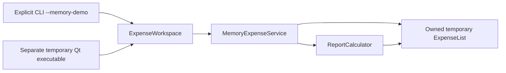
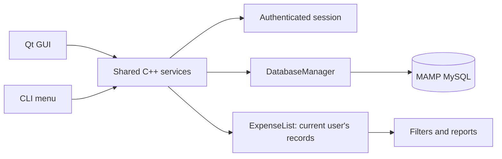
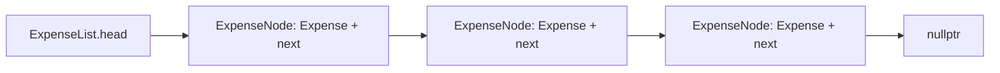
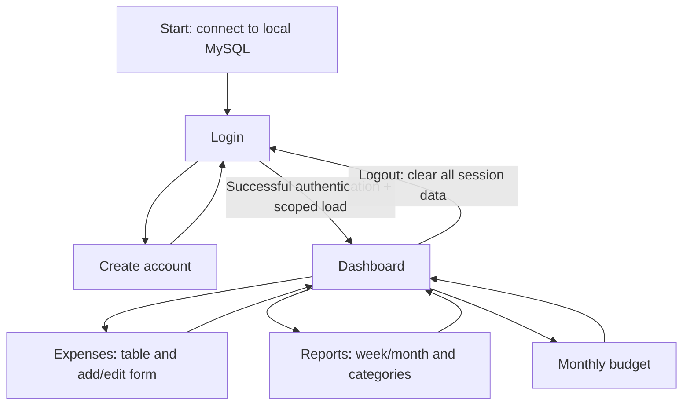

# Design through Phase 4

The implementation baseline is `docs/planning/Expense_Tracker_AI_Roadmap.txt`: C++17,
Qt 6 Widgets plus a CLI, MySQL through local MAMP, and a manually owned singly
linked list of expenses. The older teamwork roadmap excludes GUI/accounts;
the newer proposal mentioned in the AI roadmap uses SQLite and different lists.
Neither alternative is silently combined with this design. The original empty
root-level `algorithm.cpp`, `sqlite.cpp`, and `gui.cpp` placeholders were removed
during folder organization. Application sources now live under `main`, with
`main/main.cpp` for startup, `main/gui.cpp` for the main window, and `main/sql.cpp`
for the MySQL implementation. Icons live in `all asset`.

Phase 1 established interfaces, build targets, navigation, configuration, and
schema. Phase 2 implements the Expense/SLL, validation, filters, reports, and
temporary CLI/Qt forms. Phase 3 implements MySQL persistence, Argon2id account
authentication, scoped sessions, database-generated IDs, monthly budgets, and
authenticated CLI/Qt navigation. Phase 4 adds FileManager CSV parsing/export, weekly summary export, GUI ID search,
and runtime packaging; see phase4-guide.md for the file contract.

## Explicit temporary workspace

`expense_tracker_cli --memory-demo` and the separate
`expense_tracker_memory_gui` executable each create a fresh `MemoryExpenseService`.
It owns its SLL, starts empty, uses monotonically increasing temporary IDs, and
loses all records when destroyed. It has no `Session`, database connection,
account identity, fixture-loading path, or permission to read persisted data.
Normal CLI startup and `expense_tracker_gui` use the configured MySQL database
and require successful authentication. Their login controls do not open the
scratch workspace. A connection failure leaves the persistent application
unavailable until the connection can be restored.

Both temporary presentations accept the same `ExpenseWorkspace` interface.
The database-backed `ExpenseService` implements that interface as well,
so form code does not need separate validation or financial calculations.
`ReportCalculator` contains pure SLL aggregation; `ReportService` wraps it
with the production `Session::requireReadableCache()` gate. These are distinct
entry points: fixtures test pure calculations without pretending to sign in.

## Persistent ownership and data flow

Normal startup in Phase 3 connects to MySQL, authenticates the user, then loads
only that user's expenses into the SLL before exposing the dashboard/menu.
MySQL remains authoritative. Mutations validate input, commit the scoped SQL
operation, and update the SLL only after success. Insertions use the generated
database ID. A failed cache update after a commit blocks dependent actions
until a reload succeeds; it must not be reported as a failed database commit.
Connection or write failure never silently switches to unsaved operation.

`Session` holds the shared cache-ready flag and a generation counter; these
start false and zero. `AuthService` and `ExpenseService` alone may change them.
Financial views, totals, reports, and exports check `requireReadableCache()`;
authentication alone is not enough when memory is stale. `ExpenseService`
invalidates this shared state after a commit and before refreshing memory,
then marks it ready only after a complete successful refresh. Loading builds a
fresh SLL and publishes it with a nonthrowing swap; a partial read cannot replace
the previous list. A failed refresh leaves every dependent service blocked.
A reload may still use the authenticated user ID while the cache is unavailable.
The import service validates every draft before executing one transaction;
CSV parsing delegates its transaction and refresh to `ExpenseService`.
Account changes and cache invalidation/reload advance the generation so pending
results can be rejected when their generation no longer matches.

An unsuccessful SQL write can have an uncertain commit outcome after a lost
connection. The service invalidates the cache and asks the user to reload and
verify records before retrying. A confirmed write followed by a failed reload
instead explicitly says the change was saved. Neither path retries a write
automatically. Input validation errors occur before SQL and preserve a ready
cache. Budgets are read from MySQL; a budget save failure also blocks the shared
financial cache until a successful reload.

Every production financial service operation requires the current authenticated session.
SQL reads, updates, deletes, budgets, and imports obtain `user_id` from that
session. Both `expense_id` and `user_id` constrain ID-based SQL. The service also
checks session ownership; hiding GUI controls is insufficient. Imports never
accept an owner column. Logout/account switching clears the SLL, reports,
selected rows, and open forms. Background responses carry an account request epoch
so an old user's response cannot populate the new user's view.

Qt controls contain presentation code. `PersistentController` owns a dedicated
worker thread, which creates and destroys its connection, session, services,
and authoritative SLL. Password hashing and SQL work run on that thread.
Responses populate a UI snapshot only after the worker reports a readable
authenticated cache. An account request epoch rejects responses queued before
logout or account switching; the UI clears old data immediately. MySQL connector
thread ownership is checked, and no connection is shared between UI and worker.

## Classes and public contracts

| Class | Responsibility and interface contract |
| --- | --- |
| `Expense` | Private ID, integer cents, category, date, description; default and parameterized constructors; validated atomic changes implemented in Phase 2. |
| `ExpenseNode` | Exactly one `Expense` and one `next` pointer. |
| `ExpenseList` | Sole owner of SLL nodes; insert, traverse, search, update, remove, filter, total, clear, and destructor cleanup. Shallow copies are disabled. |
| `ExpenseWorkspace` | Shared presentation contract for CRUD, searches, filtering, and reports; implemented by temporary and persistent services. |
| `MemoryExpenseService` | Own an isolated Phase 2 SLL and temporary IDs; no account/session or persistence. |
| `DatabaseManager` | Own connection/resources, prepared account/expense/budget operations, generated IDs, transactions, and database errors. |
| `ExpenseService` | Shared GUI/CLI coordinator for authenticated financial operations, database-first writes, cache readiness, and reloads. |
| `FileManager` | C++ file streams, CSV validation/parsing, import coordination, transaction export, and weekly summary export. |
| `ExpenseTracker` | CLI loop and input handling; coordinate shared services instead of embedding SQL/calculations. |
| `User` | Account ID and canonical username only; never plaintext passwords. |
| `Session` | Verified current user, shared cache readiness, and generation. Only authentication/expense services can mutate this state. |
| `AuthService` | Registration, verification, retry policy, and session establishment through persistence and a password library. |
| `ExpenseFilter` | Validated inclusive date/category criteria used by both UIs, exports, counts, and totals. |
| `ReportCalculator` | Pure weekly/monthly/category aggregation from a supplied SLL, tested with fictional records. |
| `ReportService` | Gate production reports on a readable authenticated session before calling `ReportCalculator`. |
| `LoginWindow` | Login/registration presentation and validation feedback. |
| `MainWindow` | Authenticated navigation, dashboard, logout lifecycle. |
| `ExpensePage` | Table, form, category/date filters, visible count and total. |
| `ReportsPage` | Week/month selection and summary/category/day tables; weekly export is available through the CSV files tab. |
| `PersistentController` | Worker-thread ownership, asynchronous auth/writes/reload, request epochs, and gated UI snapshots. |

`ExpenseList::searchExpense(int id)` returns a borrowed `const Expense*`, or `nullptr` if no
record matches. `searchExpense(const std::string& category)` returns a
`std::vector<Expense>` containing independent value copies of all matching
records. These overloads have different result cardinalities. Borrowed record
references are valid only until the list is mutated or cleared; callers must
not delete nodes. Temporary result vectors are snapshots; the authoritative
working collection remains the required SLL.

At the `ExpenseWorkspace` boundary, ID lookup returns an `optional<Expense>`
value copy so a GUI cannot retain a pointer invalidated by an edit or deletion.
Category searches return value snapshots. Both overloads are exercised by the
Phase 2 CLI and service tests. The default `Expense` constructor creates an
unset value (ID/amount zero); list insertion rejects it. The parameterized
constructor validates a complete record. `update()` validates and allocates all
replacement fields before swapping them, preserving the old value on failure.
SLL deletion/cleanup are iterative; copy and move are disabled to prevent
accidental shared node ownership.

## Accounts and schema

`main/sql/schema.sql` defines `expense_tracker` and three InnoDB tables:

| Table | Key and ownership |
| --- | --- |
| `users` | Auto-increment `user_id`; unique canonical `username`; encoded salted password hash. |
| `expenses` | Auto-increment `expense_id`; required user FK; `DECIMAL(12,2)` amount; category/date/description; index `(user_id, expense_date)`. |
| `budgets` | Auto-increment `budget_id`; required user FK; month/year/amount; unique `(user_id, budget_year, budget_month)`. |

Explicit foreign keys reject orphan records. Restricted parent deletion prevents
an accidental account deletion from erasing its finances. No account-deletion
feature is included. The script creates missing tables without dropping data;
`IF NOT EXISTS` does not upgrade incompatible existing tables. Before applying it
to an existing database, back up the database, inspect its current schema, and
agree on account ownership. Never assign legacy records to the next registrant.
Normal startup verifies the schema and never creates, migrates, drops, or seeds
tables. Schema creation is an explicit setup operation. Verification checks
required columns/types, keys, InnoDB ownership constraints, and rejects partial
or incompatible schemas. Account/expense/budget data is accessed through prepared
statements with strict SQL mode, UTF-8, bounded connection timeouts, and automatic
reconnect disabled. SQL errors are sanitized before they reach a presentation.

Username normalization trims ASCII whitespace (`space`, tab, CR, LF, form feed,
vertical tab), then lowercases ASCII letters. Accept only `[a-z0-9_.-]` with
length 3 through 64 after normalization. Store only that canonical value. The
database's ASCII case-insensitive unique key additionally rejects case variants.
Registration handles a duplicate-key error without creating a session.

Passwords require at least 12 Unicode code points in valid UTF-8. Do not trim,
case-fold, or silently truncate passwords; confirmation must match exactly.
Inputs exceeding 4096 bytes are rejected with an explanation. Libsodium encodes
salted Argon2id hashes using its interactive operation/memory limits, and its
verification API checks passwords. Each registration receives a fresh random salt.
Only that encoded hash enters `password_hash`. Account passwords never become
MySQL credentials, log output, or cached `User` fields. Failed authentication
uses a generic invalid-credentials message. Unknown users and malformed credentials
still verify an ephemeral dummy Argon2id hash. Three failed attempts trigger a
two-second monotonic-clock delay; logout does not reset it. The Qt form disables
repeat submissions during work and the delay. The CLI hides interactive console
password echo. Successful password verification and a complete scoped expense
load are both required before publishing a session; registration does not sign in.
Every attempted sign-in first clears the prior session. Restart requires login.

## Money, text, and dates

Use USD throughout this version. Store integer cents in a signed 64-bit C++ type
and decimal strings/`DECIMAL(12,2)` in MySQL. Valid expense amounts are 1 through
999999999999 cents; budgets are 0 through 999999999999 cents. Parse/format without
floating point. Aggregations also use checked integer arithmetic. A negative
remaining budget means overspending; a missing budget differs from a zero one.

Category is trimmed of surrounding ASCII whitespace, preserves letter case,
and must be nonblank and at most 50 Unicode characters; description is a
required field, may be empty, and is at most 255 characters. Reject invalid
UTF-8 and out-of-range data before changes. Text lengths count Unicode code
points, not bytes. Embedded control characters and line breaks are rejected;
this also keeps one CLI row per expense. Do not truncate fields to fit SQL
columns. IDs are positive signed SQL `INT` values; Phase 2 allocates temporary
IDs only after successful insertion, and Phase 3 obtains IDs from MySQL.

Decimal input permits a whole-number part plus an optional one- or two-digit
fraction, with surrounding ASCII whitespace ignored. Signs, exponents, group
separators, a missing whole-number part, and excess precision are errors.
Amounts never pass through floating point. The CLI reserves `/cancel` at every
prompt; cancellation, invalid updates, and rejected deletion confirmation leave
records unchanged. Updating supplies all fields; an empty description clears it.

Dates are real Gregorian calendar dates in exact `YYYY-MM-DD` form, with supported
years 1000 through 9999 to match MySQL DATE. Budget months are 1 through 12 and
budget years use the same range. Reject zero dates and impossible leap dates.
Date-only expenses have no timezone conversion. The computer's local calendar
date determines "this week/month." Period navigation at the supported bounds
must reject unavailable adjacent periods instead of overflowing a date.

## Navigation and filter semantics

This is the implemented persistent navigation. The GUI dashboard shows current
week/month totals and the current month's budget; the CLI permits selecting a
budget year/month. Both presentations support explicit reload and logout.
The separate temporary GUI contains Expenses and Reports tabs only. Registration
returns to login after successful creation; it does not bypass password verification.

Filters offer All dates, Exact date, Custom range, This week, and This month.
Endpoints are inclusive; Exact date sets identical endpoints. A custom range
requires both valid endpoints with start no later than end. Invalid criteria
leave the current view unchanged. Category and date criteria combine with AND;
category comparison is case-sensitive and exact after the same surrounding
ASCII-whitespace trimming used on entry. Clearing filters restores the current user's records and
refreshing preserves selected filters.

The same predicate currently determines table rows, counts, and totals; the
CLI filtered CSV export reuses it. GUI Export all and Export filtered records are distinct actions.
Dashboard week/month totals and monthly budget remaining are independent of the
expense-table filter and label their
periods explicitly. Monthly totals include both year and month.

A selected weekly report covers Monday through Sunday containing the chosen
date, including weeks crossing month/year boundaries. Show actual start/end
dates and Previous week, Next week, This week navigation. Output a transaction
count, total, seven daily rows including zeros, category totals, and daily
average = total / 7 (round only for display). Daily totals and category totals
each sum to the weekly total. An empty week displays zeros and an explanatory
message. Weekly budgets are not part of this project.

## CSV contract and independent fixtures

Transaction CSV columns are exactly
`expense_id,amount,category,expense_date,description`. UTF-8 text, decimal amounts,
and ISO dates use the same field validation as interactive entry. Quote fields
containing commas or quotes and escape embedded quotes by doubling them.
This version rejects quoted line breaks with a row error rather than silently
splitting a record. Validate the complete import before saving anything, then
insert all rows in one transaction. Ignore source expense IDs and use generated
IDs; reimporting intentionally creates additional records. Owner IDs never come
from CSV. Roll back failed imports and reload the SLL only after commit. Confirm
before overwriting an existing export file.

Weekly summary export is a separate format that includes the date range and USD;
it cannot be imported as transactions. `tests/fixtures/weekly_expenses.csv` is
fictional and independent of production startup. Its companion notes contain
hand-calculated results for later phases; it is never loaded to enable login.
